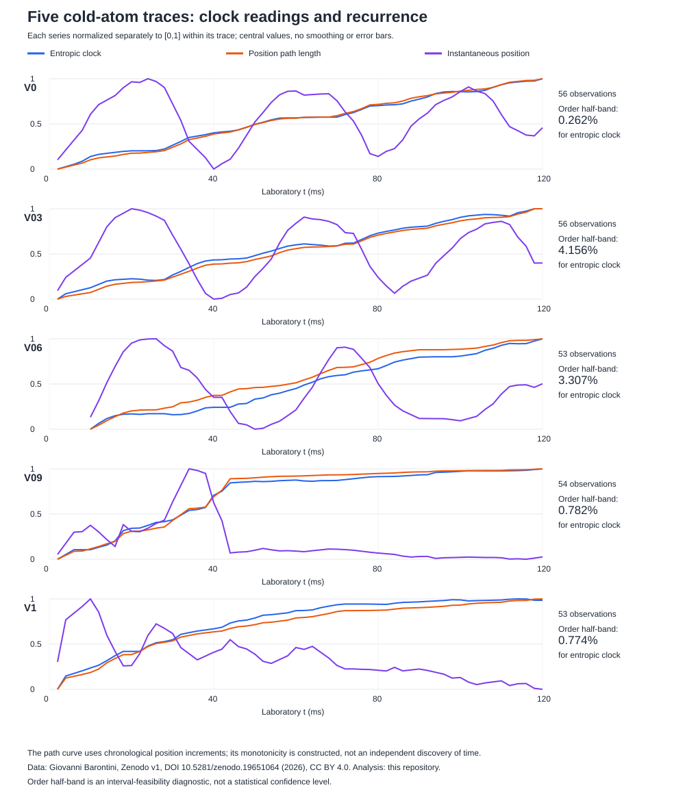

# Comparing clocks on all five released cold-atom traces

## 1. Constructive result

We now compare clock readings on **all five experimental traces, 272 observations**, from Giovanni Barontini's *Testing the problem of time with cold atoms*, Physical Review Research 8, L022047 (2026), DOI [10.1103/1h9j-df4k](https://doi.org/10.1103/1h9j-df4k), and [Zenodo dataset v1](https://zenodo.org/records/19651064).

The empirical conclusions are deliberately separated:

1. The entropic clock is compatible with a strictly ordered calibration inside illustrative relative 5% boxes on every trace; instantaneous position is not globally monotonic under that same diagnostic.
2. A cumulative position-path clock also orders every sampled event, but it consumes the supplied chronology and an accumulator. Its success does not independently derive time.
3. Held-out width interpolation does not select a unique physical clock. Results depend strongly on the split, event coverage and added record labels.
4. At stated finite readout resolutions, recurring position bins require additional labels to predict the retained width. We give an explicit conditional label-capacity bound, not a claim to have measured clock hardware bits.

This is a processed-data benchmark for the direct time programme, not a raw-image replication, an independently reconstructed entropy clock, or a solution of gravitational time.

## 2. Source integrity and reproducibility

The [previous source audit](COLD_ATOM_ENTROPIC_CLOCK_AUDIT.md) read the full paper/supplement and checked two column subsets. We now retain every column and row in the five released Fig2Fig3 experimental files. Numerical Fig3/Fig4 simulation files are not included in this empirical comparison.

Sources, CC BY 4.0 attribution, URLs and hashes are in the [manifest](verification/sources/barontini_2026/manifest.json). The local text files normalize tabs to spaces and CRLF to LF. Reversing **exactly** those changes reproduces every Zenodo-listed original byte size and MD5. Thus the complete numerical transcriptions now have a verified original-format checksum, not merely a locally computed hash. SHA256 additionally pins each normalized local file. The earlier two-trace transcription is cross-checked without rewriting its historical provenance claim.

Run [cold_atom_comparison.py](verification/cold_atom_comparison.py), directly or as a module. [Full results](verification/cold_atom_comparison.json) include source checks, exact-order witnesses, all interpolation coverage, positive-width sensitivity, sampling sensitivity and record bounds. Features and interpolation use exact fractions from published decimals; summary RMSEs use floating-point square roots.

All source files are sorted by their tau column. Analysis sorts copies by laboratory t; it never infers chronology from source row order. No missing times are filled. The sigma column is a fitted cloud width, not an uncertainty bar. Each trace contains one zero-width central value; these are retained as published and a positive-width-only interpolation sensitivity is also reported. They are not interpreted as physical zero-size singularities.

## 3. What was compared

For the chronological observations i, the six descriptions are:

- **Laboratory t:** an external reference baseline, not an internally derived clock.
- **Entropic tau:** the paper's released processed value; its entropy construction is not recomputed here.
- **Instantaneous position phi:** the measured bright-sector center of mass.
- **Orientation plus position:** phi and a causal hysteresis direction inferred from the past position sequence.
- **Leg-record plus position:** adds a counter of detected direction reversals.
- **Cumulative position path L_i=sum_(j<=i)|phi_j-phi_(j-1)|:** a history-dependent internal-variable accumulator.

Direction changes are accepted after a 1 micrometer reversal from a running extremum. The initial direction is unknown until the threshold is crossed. This is a declared analysis choice, **not** a preregistered experimental calibration or a measured momentum sign. Sensitivity thresholds are 0.5, 2 and 4 micrometers as well.

Every path/direction/record construction uses the supplied laboratory ordering. Neither our L clock nor this computation of the paper's tau demonstrates a self-contained real-time accumulator in one atomic run. The image-derived sequence and the physical implementation of a cumulative register are different deliverables.

## 4. Ordering: a constructive uncertainty-box diagnostic

Central-value reversals alone do not establish a clock failure. For nonnegative clock readings c_i and an assumed adjustable relative half-band e, ask whether increasing values z_i can be chosen with

    c_i(1-e)<=z_i<=c_i(1+e).

For a nondecreasing calibration, the exact minimum half-band is

    e_min=max_(i<j) max(0,(c_i-c_j)/(c_i+c_j)),

omitting zero denominators. Proof: all earlier lower bounds must be no larger than each later upper bound; these pairwise inequalities are also sufficient via cumulative maxima of lower bounds.

We additionally construct a **strictly increasing witness**. For lower/upper bounds l_i,u_i, let

    g_max=min_(i<j) (u_j-l_i)/(j-i).

If g_max>0, recursively choose z_0=l_0 and z_i=max(l_i,z_(i-1)+g_max/2). The same inequalities prove every z_i is inside its box and all increments are positive. The JSON stores all five exact rational witnesses.

| Trace | Rows | Adjacent central tau decreases | Minimum tau half-band | Best global position half-band* |
|---|---:|---:|---:|---:|
| V0 | 56 | 3 | 0.2622% | 70.5482% |
| V03 | 56 | 9 | 4.1561% | 66.6981% |
| V06 | 53 | 3 | 3.3071% | 67.0209% |
| V09 | 54 | 4 | 0.7819% | 49.1724% |
| V1 | 53 | 7 | 0.7739% | 16.5316% |

*The position column permits whichever single global direction, increasing or decreasing, needs the smaller half-band. Position may still be a valid **local** clock with branch information.

Every entropic trace has a strictly increasing witness within relative 5% boxes. This supports the paper's use of tau as an approximate ordering parameter despite central wiggles. It does not establish an uncertainty probability: the paper's approximate 5% statistical uncertainty is not a specified simultaneous hard box or covariance model. In particular, V03/V06 have adjacent central drops above 5%; comparing such a difference directly with one point's nominal 5% is not a valid statistical significance calculation.

The calibrated witnesses are mathematical feasibility witnesses, not revised data or a new derivation of Eq. (3). They have not been required to satisfy the missing entropy/population reconstruction equations.

## 5. Clock fibers and limited resolution

The released exact central tau ties have these maximum within-fiber width spans:

| Trace | Largest width span at identical central tau |
|---|---:|
| V0 | 1.0757 micrometers |
| V03 | 1.2483 micrometers |
| V06 | 2.5120 micrometers |
| V09 | 0.2816 micrometers |
| V1 | 0.0750 micrometers |

For central values treated as exact, any single-valued width predictor on that tau fiber has worst absolute error at least half the span. The best squared-error fit has the fiber mean, giving a computable within-fiber residual floor. Both quantities are in the output.

These are **not** uncertainty-certified physical obstructions. If clock uncertainties resolve the apparent ties, the true fibers differ. Section 4 explicitly shows that an ordered calibration is possible under the illustrative boxes. The point is to state the finite-resolution distinction, not to turn rounded/estimated central ties into a no-go theorem for the experiment.

## 6. Held-out observable interpolation, with coverage controlled

We held out the cloud-width column and fitted a piecewise-linear function of each proposed clock. Training duplicates are replaced by their mean. There is no extrapolation. Orientation/leg descriptions fit separately within their record labels.

Two deterministic five-fold splits are used:

- **Interleaved:** observation index modulo five; neighboring samples remain in training.
- **Blocked:** five contiguous blocks of observation indices; a whole stretch of evolution is missing in each test fold.

Clock inputs use the released processed values or the complete position path. Thus these are conditional interpolation tests, **not forecasting from past data alone**. Moreover tau and width are derived from the same images; the entropy estimator may share information with the target. Holding out the width column does not hold out the image-generation pipeline or establish a new physical prediction.

The following comparisons use **identical covered test rows** for the three listed clocks. Errors are width RMSE in micrometers. Source zero-width entries are included; the output also reports the stated positive-width sensitivity.

### Interleaved split

| Trace | Common test rows | Entropic tau | Position path L | Laboratory t |
|---|---:|---:|---:|---:|
| V0 | 54 | 0.653 | 0.329 | 0.402 |
| V03 | 54 | 0.796 | 0.343 | 0.393 |
| V06 | 51 | 1.095 | 0.686 | 0.773 |
| V09 | 52 | 0.297 | 0.283 | 0.470 |
| V1 | 50 | 0.227 | 0.137 | 0.148 |

L has smaller error than tau in this particular interpolator and split. This is **not** evidence that L is the fundamental or physically superior time: it already encodes order, depends on sampling, and uses a different image-derived input. Nor does a poor linear interpolation reject a valid nonlinear physical evolution.

### Blocked split

| Trace | Common test rows | Entropic tau | Position path L | Laboratory t |
|---|---:|---:|---:|---:|
| V0 | 33 | 3.188 | 3.192 | 3.392 |
| V03 | 33 | 3.090 | 3.061 | 3.252 |
| V06 | 32 | 1.879 | 1.437 | 1.775 |
| V09 | 33 | 1.984 | 1.891 | 1.909 |
| V1 | 32 | 0.320 | 0.215 | 0.216 |

Errors often rise sharply when a contiguous segment is absent. Record labels also reduce coverage: the leg-record model covers **zero** blocked test points in V0 and V03, because the held-out leg has no adequate same-label training range. A counter can distinguish events without supplying an evolution law for a previously uncalibrated leg.

The JSON includes all six clocks and paired same-row comparisons against tau, not just favorable numbers. There is no reported p value, uncertainty-weighted model selection, fitted Hamiltonian or independent cross-barrier validation.

## 7. Accumulator and orientation sensitivity

L increases strictly on all sampled traces because every consecutive measured phi differs. Its ordering is a mathematical consequence of its definition, not new evidence for a universal arrow.

It is sampling dependent. Retaining every third observation plus the endpoints preserves about 88.6% of full sampled path length in V0, but only 72.4% in V1. Some lost length is real unresolved motion and some may be noise; these data do not separate them. The subsampling patterns are not nested, so their ratios need not vary monotonically with stride.

Detected reversal counts are also resolution dependent. V1 has 7 reversals at 0.5 micrometers, 5 at 1, 3 at 2, and none at 4. This does not certify any one as the true cycle count. A clock counter needs an operationally justified resolution/filter and uncertainty model, not arbitrary counting of every sign change.

## 8. A conditional bound on the extra labels

Suppose a device reports only a 1 micrometer position bin and an auxiliary record r. Require a deterministic width readout within tolerance delta of each retained central width. Two widths separated by more than 2*delta cannot share both clock bin and record label. If k such mutually separated widths occur in one bin, at least k record labels are required there. A binary memory supplying them needs at least ceil(log2 k) bits.

The code finds the exact one-dimensional minimum number of width-radius-delta covering groups by greedily taking the smallest uncovered width and covering through width+2*delta. Its witness set is correspondingly pairwise separated. This is a finite-resolution readout theorem, not a thermodynamic entropy or a neural-subject bound.

For example, in V0 the position bin [29,30) micrometers contains the following witnesses:

| Laboratory t | Cloud width, micrometers |
|---:|---:|
| 56 | 5.2757 |
| 62 | 6.0784 |
| 66 | 7.4449 |
| 68 | 8.5206 |
| 106 | 9.3858 |

At assumed width tolerance 0.25 micrometers, all five are mutually separated by more than 0.5 micrometers. Thus five auxiliary labels, or at least three binary memory bits if memory supplies them, are necessary for that prescribed readout model.

This does not mean the apparatus actually stores three bits of winding count. Additional information could be an instantaneous variable, orientation, a cycle/leg record, or improved position resolution. The bound is conditional on the chosen coarse clock and width tolerance and on treating the central values as targets. No experimental uncertainty certification or optimal physical register construction follows.

## 9. Consequence for the problem-of-time programme

The experimental benchmark supports a more precise target than “find a monotonically increasing scalar”:

1. Specify the measured clock variables, uncertainty, resolution and retained event algebra.
2. State whether the clock is instantaneous or history-dependent, and supply the required accumulator/branch information.
3. Distinguish event ordering from predictive dynamics and carry anchored events consistently between clock descriptions.
4. Calibrate and test the effective dynamics on independent trials/barrier settings without feeding the target image-derived information back into its clock input unexamined.

The data do not select a unique actual time, validate our exact constrained models, or settle the mathematical issues in the paper's printed dynamics. They do provide a real common set of trajectories on which competing clock descriptions can be checked. [The operational accumulator construction](OPERATIONAL_PATH_ACCUMULATOR.md) now supplies a reversible discrete-model counter and explicit threshold-event conversion instrument, with finite-resolution arithmetic replay on these traces. Deriving and validating an accumulator/conversion law for the actual atom cloud remains a constructive task; image-level population/entropy inputs and covariance are needed for full reconstruction.

This is direct empirical support work for M0/W1-W6 time research, not a return to unrelated access-cost results or a claim that gravitational refoliation, phenomenal passage or necessary actuality has been solved.
